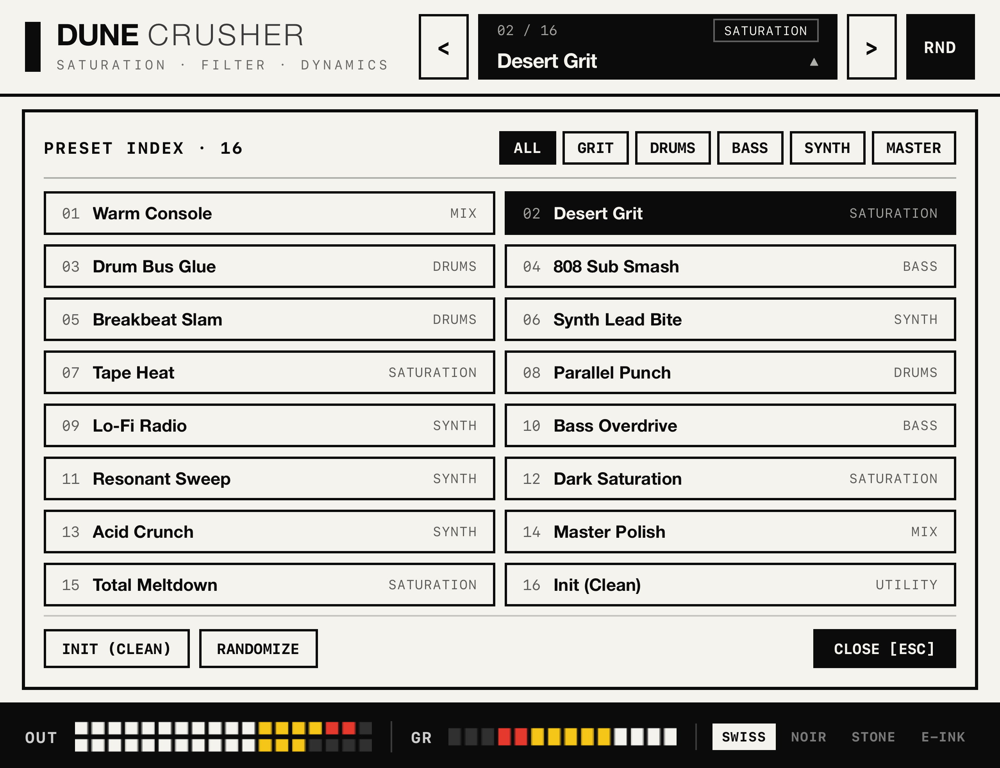

# DuneCrusher

An open-source multi-effect **saturation, resonant low-pass filter, and one-knob dynamics** audio plugin built with **C++20**, **JUCE 8 (`WebBrowserComponent`)**, and a **React 19 + Vite + Tailwind CSS v4** monochrome Swiss-hardware interface (AU & VST3, native Apple Silicon `arm64`).


## Features

- **Dual-Stage Saturation (`01 DRIVE`)** — Pre-filter aggressive piecewise-linear waveshaping (**Bite**) paired with post-filter smooth quadratic tube-style saturation (**Warmth**), with a live real-time transfer waveform scope.
- **Resonant 12 dB/oct Low-Pass Filter (`02 FILTER`)** — Smoothed logarithmic cutoff (`80 Hz – 16 kHz`), high-Q resonance, live RBJ frequency-response scope, Nyquist stability clamping (`11.025 kHz – 192 kHz`), and an integrated post-filter peak safety limiter.
- **One-Knob Dynamics (`03 COMPRESSOR`)** — Automatic makeup gain with two character modes:
  - **GLUE** — Smooth linear-slew envelope follower (`30 ms` attack / `80 ms` release).
  - **SLAM** — Instant peak-driven brickwall punch with ultra-fast release.
- **Parallel Blending & Output Stage (`04 MASTER`)** — Smooth wet/dry **Mix**, tapered output **Volume**, and final soft-safe clipping protection (`±0.9999`).
- **Editorial B&W WebView Interface** — Built in **React + Tailwind CSS** and bundled into a single zero-dependency embedded HTML payload inside the AU/VST3 binary:
  - **Mono Swiss** default aesthetic (bone-white & jet-black Dieter Rams / Braun industrial layout) plus 3 built-in monochrome theme presets (**NOIR**, **STONE**, **E-INK**) switchable directly from the bottom bar.
  - **Studio-Graded Signal Metering** — Jet-black bottom metering strip with bone-white → signal-yellow → signal-red **OUT L/R** and **GR** segmented LED bars.
  - **Integrated 16-Preset Bank** — Categorized index (`ALL`, `GRIT`, `DRUMS`, `BASS`, `SYNTH`, `MASTER`), `Shift+Drag` fine control, double-click reset, controlled **RND** generator, and `.dcpreset` XML import/export.
- **Real-Time Safe C++20 DSP** — Allocation-free, lock-free audio thread (`processBlock`), denormal flushing, and `NaN`/`Inf` input sanitization.



## Signal Flow


## Building from Source

### Requirements
- CMake `3.22+`
- C++20 compiler (Xcode / Apple Clang on macOS, MSVC 2022 on Windows, GCC 11+ / Clang 15+ on Linux)
- *(Optional)* Node.js `20+` if modifying the React/Tailwind frontend under `ui/` (a pre-bundled `ui/dist/index.html` is included so pure CMake builds work out of the box).
- Internet access on first CMake configure to fetch JUCE `8.0.17-security`, or pass `-DDUNECRUSHER_JUCE_DIR=/path/to/JUCE` to reuse a local checkout.

### macOS (Apple Silicon `arm64`)

```bash
cmake -B build -DCMAKE_BUILD_TYPE=Release -DCMAKE_OSX_ARCHITECTURES=arm64
cmake --build build --config Release --parallel
```

For a Universal macOS binary (`arm64` + `x86_64`), pass `-DCMAKE_OSX_ARCHITECTURES="arm64;x86_64"`.

Built bundles are placed under:
- `build/DuneCrusher_artefacts/Release/AU/DuneCrusher.component`
- `build/DuneCrusher_artefacts/Release/VST3/DuneCrusher.vst3`

To install on macOS:

```bash
cp -R build/DuneCrusher_artefacts/Release/AU/DuneCrusher.component ~/Library/Audio/Plug-Ins/Components/
cp -R build/DuneCrusher_artefacts/Release/VST3/DuneCrusher.vst3 ~/Library/Audio/Plug-Ins/VST3/
```

### Rebuilding the WebView UI (`ui/`)

```bash
cd ui
npm ci
npm run build   # outputs single-file ui/dist/index.html embedded by CMake
```

### Windows / Linux (VST3)

```bash
cmake -B build -DCMAKE_BUILD_TYPE=Release
cmake --build build --config Release --parallel
```

## Verification & Tests

Run the headless C++20 DSP test suite:

```bash
ctest --test-dir build --output-on-failure
```

Run the hosted VST3 + JUCE 8 WebView runtime smoke verifier:

```bash
./build/dunecrusher_verify_artefacts/Release/dunecrusher_verify \
  ./build/DuneCrusher_artefacts/Release/VST3/DuneCrusher.vst3
```

## Factory Presets

| # | Preset | Category | Character |
|---|---|---|---|
| 01 | **Warm Console** | Mix & Master | Subtle bus warmth & gentle Glue leveling |
| 02 | **Desert Grit** | Saturation | Full-chain saturation, resonant LP, and Slam punch |
| 03 | **Drum Bus Glue** | Drums | Parallel drum compression with light harmonic sheen |
| 04 | **808 Sub Smash** | Bass & 808 | Deep low-passed sub saturation & heavy Slam sustain |
| 05 | **Breakbeat Slam** | Drums | Aggressive drum break squashing with parallel blend |
| 06 | **Synth Lead Bite** | Synth & Filter | Cutting pre-filter Bite into resonant peak |
| 07 | **Tape Heat** | Saturation | Smooth Warmth-only saturation with soft top-end roll-off |
| 08 | **Parallel Punch** | Drums | Heavy New York-style parallel drive + Slam mix |
| 09 | **Lo-Fi Radio** | Synth & Filter | Band-limited resonant coloration and gritty crush |
| 10 | **Bass Overdrive** | Bass & 808 | Thick mid-focused bass drive and tight dynamics |
| 11 | **Resonant Sweep** | Synth & Filter | Pure high-Q filter movement with gentle compression |
| 12 | **Dark Saturation** | Saturation | Heavy Bite tamed by a low-cutoff filter |
| 13 | **Acid Crunch** | Synth & Filter | High resonance pushed hard into Slam mode |
| 14 | **Master Polish** | Mix & Master | Subtle finishing warmth and micro-glue |
| 15 | **Total Meltdown** | Saturation | Maximum saturation, resonance, and Slam destruction |
| 16 | **Init (Clean)** | Utility | Clean neutral starting point |

## License

DuneCrusher is free software licensed under the **GNU Affero General Public License v3.0 (AGPL-3.0)** — see [LICENSE](LICENSE) for details. Built with the open-source edition of [JUCE 8](https://github.com/juce-framework/JUCE).
