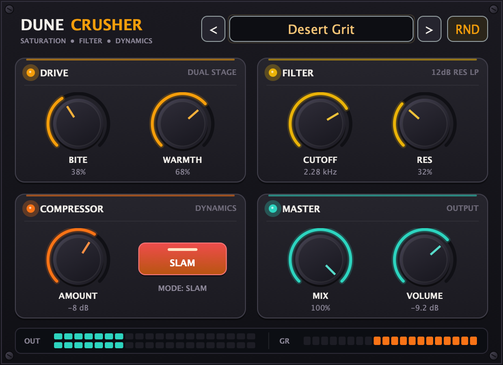
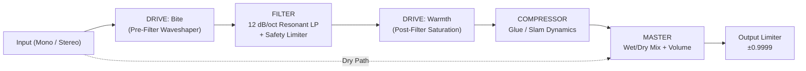

# DuneCrusher

An open-source multi-effect **saturation, resonant low-pass filter, and one-knob dynamics** audio plugin written in modern **C++20** and **JUCE 8** (AU & VST3, native Apple Silicon `arm64`).



## Features

- **Dual-Stage Saturation (`DRIVE`)** — Pre-filter aggressive piecewise-linear waveshaping (**Bite**) paired with post-filter smooth quadratic tube-style saturation (**Warmth**).
- **Resonant 12 dB/oct Low-Pass Filter (`FILTER`)** — Smoothed logarithmic cutoff (`80 Hz – 16 kHz`), high-Q resonance, Nyquist safety clamping (stable from `11.025 kHz` to `192 kHz`), and an integrated post-filter peak safety limiter.
- **One-Knob Dynamics (`COMPRESSOR`)** — Automatic makeup gain with two character modes:
  - **GLUE** — Smooth linear-slew envelope follower (`30 ms` attack / `80 ms` release).
  - **SLAM** — Instant peak-driven brickwall punch with ultra-fast release.
- **Parallel Blending & Output Stage (`MASTER`)** — Smooth wet/dry **Mix**, tapered output **Volume**, and final soft-safe clipping protection (`±0.9999`).
- **Bespoke HiDPI Vector Interface** — 100% procedural JUCE vector rendering (zero bitmap assets), color-coded glowing rotary controls, automatic bypassed-module dimming, transient OLED parameter readouts, live stereo **OUT L/R** and **GR** segmented LED meters, controlled **RND** parameter generator, and `.dcpreset` XML save/load.
- **Real-Time Safe C++20 DSP** — Allocation-free, lock-free audio thread (`processBlock`), denormal flushing, `NaN`/`Inf` input sanitization, and 16 original factory presets.

## Signal Flow



## Building from Source

### Requirements
- CMake `3.22+`
- C++20 compiler (Xcode / Apple Clang on macOS, MSVC 2022 on Windows, GCC 11+ / Clang 15+ on Linux)
- Internet access on first configure (fetches JUCE `8.0.17-security` automatically via `FetchContent`), or pass `-DDUNECRUSHER_JUCE_DIR=/path/to/JUCE` to reuse a local checkout.

### macOS (Apple Silicon `arm64`)

```bash
cmake -B build -DCMAKE_BUILD_TYPE=Release -DCMAKE_OSX_ARCHITECTURES=arm64
cmake --build build --config Release --parallel
```

For a Universal macOS binary (`arm64` + `x86_64`), pass `-DCMAKE_OSX_ARCHITECTURES="arm64;x86_64"`.

Built bundles are placed under:
- `build/DuneCrusher_artefacts/Release/AU/DuneCrusher.component`
- `build/DuneCrusher_artefacts/Release/VST3/DuneCrusher.vst3`

To install on macOS:

```bash
cp -R build/DuneCrusher_artefacts/Release/AU/DuneCrusher.component ~/Library/Audio/Plug-Ins/Components/
cp -R build/DuneCrusher_artefacts/Release/VST3/DuneCrusher.vst3 ~/Library/Audio/Plug-Ins/VST3/
```

### Windows / Linux (VST3)

```bash
cmake -B build -DCMAKE_BUILD_TYPE=Release
cmake --build build --config Release --parallel
```

## Verification & Tests

Run the headless C++20 DSP test suite (bypass bit-exactness, waveshaper response, filter attenuation, Glue vs Slam dynamics, `11–192 kHz` stability, `NaN`/`Inf` recovery, preset bounds):

```bash
ctest --test-dir build --output-on-failure
```

Run the hosted VST3 runtime verifier (discovers and instantiates the compiled `DuneCrusher.vst3`, runs multi-rate audio + `NaN`/`Inf` stress tests, checks state serialization round-trip, and verifies editor lifecycle):

```bash
./build/dunecrusher_verify_artefacts/Release/dunecrusher_verify \
  ./build/DuneCrusher_artefacts/Release/VST3/DuneCrusher.vst3
```

## Factory Presets

| # | Preset | Character |
|---|---|---|
| 1 | **Warm Console** | Subtle bus warmth & gentle Glue leveling |
| 2 | **Desert Grit** | Full-chain saturation, resonant LP, and Slam punch |
| 3 | **Drum Bus Glue** | Parallel drum compression with light harmonic sheen |
| 4 | **808 Sub Smash** | Deep low-passed sub saturation & heavy Slam sustain |
| 5 | **Breakbeat Slam** | Aggressive drum break squashing with parallel blend |
| 6 | **Synth Lead Bite** | Cutting pre-filter Bite into resonant peak |
| 7 | **Tape Heat** | Smooth Warmth-only saturation with soft top-end roll-off |
| 8 | **Parallel Punch** | Heavy New York-style parallel drive + Slam mix |
| 9 | **Lo-Fi Radio** | Band-limited resonant coloration and gritty crush |
| 10 | **Bass Overdrive** | Thick mid-focused bass drive and tight dynamics |
| 11 | **Resonant Sweep** | Pure high-Q filter movement with gentle compression |
| 12 | **Dark Saturation** | Heavy Bite tamed by a low-cutoff filter |
| 13 | **Acid Crunch** | High resonance pushed hard into Slam mode |
| 14 | **Master Polish** | Subtle finishing warmth and micro-glue |
| 15 | **Total Meltdown** | Maximum saturation, resonance, and Slam destruction |
| 16 | **Init (Clean)** | Clean neutral starting point |

## License

DuneCrusher is free software licensed under the **GNU Affero General Public License v3.0 (AGPL-3.0)** — see [LICENSE](LICENSE) for details. Built with the open-source edition of [JUCE 8](https://github.com/juce-framework/JUCE).
